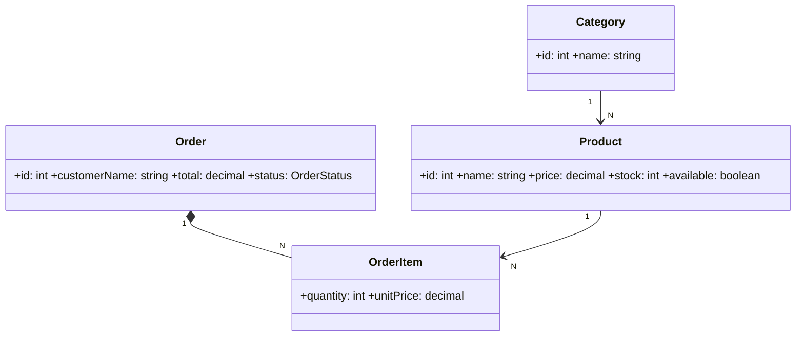
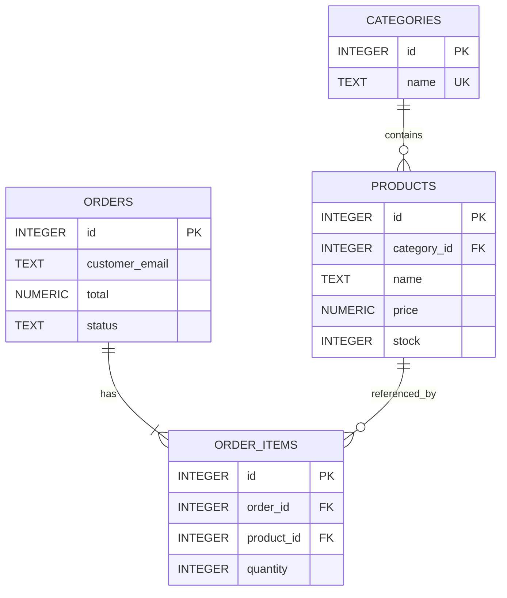

# 2. Modelagem conceitual, lógica e física

## Diagrama de classes

## DER

O modelo está normalizado até a terceira forma normal: dados de categoria não são repetidos nos produtos, e itens de pedido preservam o nome/preço histórico para manter a integridade comercial mesmo se o catálogo mudar. O projeto físico está em [`database/schema.sql`](../database/schema.sql) e é materializado via SQLAlchemy com SQLite e foreign keys habilitadas.
